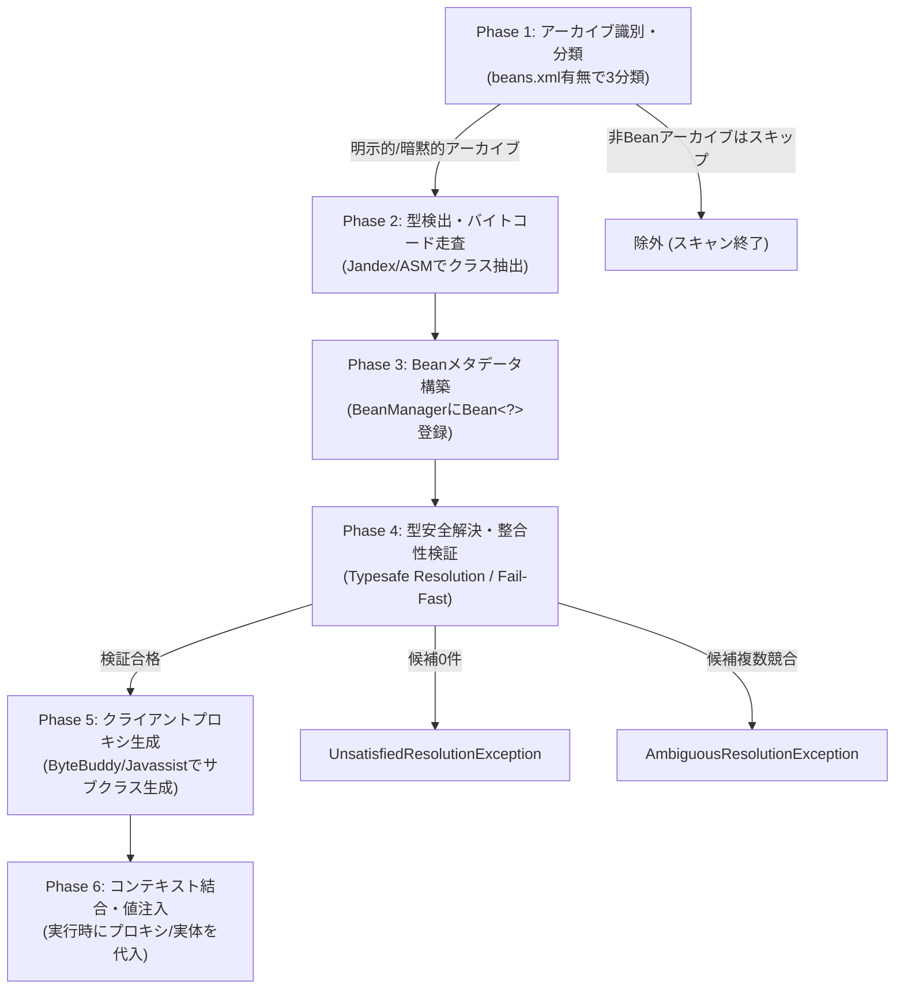

# CDIのBeanアーカイブと@Inject完全技術解説書

> **対象読者**: CDI（Jakarta Contexts and Dependency Injection / Java EE）を利用するJavaエンジニア、アーキテクト、および「アノテーションを書いたのにDIが全く動かない」というトラブルに直面したすべての開発者  
> **対応バージョン**: CDI 1.0 / 1.1 / 1.2 / 2.0 / 3.0 / 4.0 (Jakarta EE 10) / 4.1 (Jakarta EE 11)  
> **同梱成果物**: `CDI_BeanArchive_Complete_Specification.xlsx`（Meiryo UIフォント・モノトーン配色仕様書）

---

## 目次

1. [第1章：エグゼクティブサマリー & 小学生でも3分でわかる「学校の給食当番」超図解](#第1章エグゼクティブサマリー--小学生でも3分でわかる学校の給食当番超図解)
   - [1.1 CDIの基本概念を「学校の給食当番」にたとえる](#11-cdiの基本概念を学校の給食当番にたとえる)
   - [1.2 事件の真相：なぜ「@Inject」と書いたのに先生（CDI）に無視されるのか？](#12-事件の真相なぜinjectと書いたのに先生cdiに無視されるのか)
   - [1.3 なぜ先生は全教室を見回らないのか？（マンモス校の朝礼問題）](#13-なぜ先生は全教室を見回らないのかマンモス校の朝礼問題)
2. [第2章：CDI登場の歴史と背景 — なぜ「Beanアーカイブ」が必要だったのか？](#第2章cdi登場の歴史と背景--なぜbeanアーカイブが必要だったのか)
   - [2.1 前史：Java EE 5以前の混沌とSpring/Guiceの台頭](#21-前史java-ee-5以前の混沌とspringguiceの台頭)
   - [2.2 CDI 1.0 (2009, Java EE 6)：厳格なオプトインモデルと「beans.xml」の義務化](#22-cdi-10-2009-java-ee-6厳格なオプトインモデルとbeansxmlの義務化)
   - [2.3 CDI 1.1 / 1.2 (2013, Java EE 7)：「暗黙的アーカイブ」の誕生と新たな罠](#23-cdi-11--12-2013-java-ee-7暗黙的アーカイブの誕生と新たな罠)
   - [2.4 CDI 2.0 (2017, Java EE 8)：Java SE対応と軽量化（`<trim/>`）](#24-cdi-20-2017-java-ee-8java-se対応と軽量化trim)
   - [2.5 CDI 3.0 (2020, Jakarta EE 9)：`javax` から `jakarta` への移行](#25-cdi-30-2020-jakarta-ee-9javax-から-jakarta-への移行)
   - [2.6 CDI 4.0 / 4.1 (2022〜最新, Jakarta EE 10/11)：CDI Liteと空XMLの破壊的変更](#26-cdi-40--41-2022最新-jakarta-ee-1011cdi-liteと空xmlの破壊的変更)
3. [第3章：Beanアーカイブの3大分類と動作モード完全マトリクス](#第3章beanアーカイブの3大分類と動作モード完全マトリクス)
   - [3.1 アーカイブの3大分類（明示的・暗黙的・非アーカイブ）](#31-アーカイブの3大分類明示的暗黙的非アーカイブ)
   - [3.2 `bean-discovery-mode` の3大値（annotated / all / none）完全比較](#32-bean-discovery-mode-の3大値annotated--all--none完全比較)
   - [3.3 「Bean定義アノテーション」判定リスト（スコープ vs 注入ポイント）](#33-bean定義アノテーション判定リストスコープ-vs-注入ポイント)
4. [第4章：「@Injectが丸ごと効かない」5大失敗パターンの徹底解剖と処方箋](#第4章injectが丸ごと効かない5大失敗パターンの徹底解剖と処方箋)
   - [4.1 パターン1：親（呼び出し元）がCDI管理外の罠（手動 `new`、非管理サーブレット）](#41-パターン1親呼び出し元がcdi管理外の罠手動-new非管理サーブレット)
   - [4.2 パターン2：注入対象が非Beanアーカイブ（サードパーティJAR）](#42-パターン2注入対象が非beanアーカイブサードパーティjar)
   - [4.3 パターン3：暗黙的アーカイブのスコープ省略罠（@Injectだけ書いたクラス）](#43-パターン3暗黙的アーカイブのスコープ省略罠injectだけ書いたクラス)
   - [4.4 パターン4：CDI 4.0移行に伴う空のbeans.xml挙動変化の罠](#44-パターン4cdi-40移行に伴う空のbeansxml挙動変化の罠)
   - [4.5 パターン5：ファイル名・物理配置パス不一致の罠（META-INF vs WEB-INF）](#45-パターン5ファイル名物理配置パス不一致の罠meta-inf-vs-web-inf)
5. [第5章：`beans.xml` 設定完全リファレンス](#第5章beansxml-設定完全リファレンス)
   - [5.1 バージョン別 XSD スキーマ宣言完全サンプル](#51-バージョン別-xsd-スキーマ宣言完全サンプル)
   - [5.2 ルート要素・全属性・全子タグリファレンス](#52-ルート要素全属性全子タグリファレンス)
   - [5.3 `<scan>` タグによる高度なフィルタリング設定](#53-scan-タグによる高度なフィルタリング設定)
   - [5.4 アーカイブ種別・ビルドツール別 物理配置パス一覧](#54-アーカイブ種別ビルドツール別-物理配置パス一覧)
6. [第6章：CDIコンテナの内部動作原理と処理フロー（深堀り）](#第6章cdiコンテナの内部動作原理と処理フロー深堀り)
   - [6.1 コンテナ起動時の内部処理 6大フェーズ](#61-コンテナ起動時の内部処理-6大フェーズ)
   - [6.2 クライアントプロキシ（Client Proxy）の動作原理と通常スコープの仕組み](#62-クライアントプロキシclient-proxyの動作原理と通常スコープの仕組み)
   - [6.3 ライフサイクル管理とデリゲーションの内部イメージ](#63-ライフサイクル管理とデリゲーションの内部イメージ)
7. [第7章：実務トラブルシューティング決定木 & デバッグログ採取ガイド](#第7章実務トラブルシューティング決定木--デバッグログ採取ガイド)
   - [7.1 自己診断チェックリスト（診断フロー）](#71-自己診断チェックリスト診断フロー)
   - [7.2 サーバー・フレームワーク別 CDIデバッグログ有効化コマンド](#72-サーバーフレームワーク別-cdiデバッグログ有効化コマンド)
8. [第8章：まとめと実務への提言](#第8章まとめと実務への提言)

---

## 第1章：エグゼクティブサマリー & 小学生でも3分でわかる「学校の給食当番」超図解

### 1.1 CDIの基本概念を「学校の給食当番」にたとえる

JavaのCDI（Contexts and Dependency Injection）は、オブジェクト同士の「部品の組み立て」と「命（ライフサイクル）の管理」を自動で行ってくれる強力な仕組みです。しかし、設定を一歩でも間違えると、**「コードにはちゃんと `@Inject` と書いてあるのに、実行すると完全に無視されて中身が `null` のまま動き、システムがクラッシュする」** という事態に陥ります。

この難解な仕組みを、**「小学校の給食当番」** にたとえてみましょう。

```
【小学校のたとえ】
┌─────────────────────────────────────────────────────────────┐
│ 学校全体（Javaアプリケーション / クラスパス）               │
│                                                             │
│  [給食の先生 (CDIコンテナ)]                                 │
│    │                                                        │
│    ├─ 教室Aのドアに看板あり「給食当番います！」(beans.xml)  │
│    │   └─ 生徒（Bean）に道具（@Inject）を届ける！ [大成功]  │
│    │                                                        │
│    └─ 教室Bのドアに看板なし（非Beanアーカイブ）             │
│        └─ 先生は教室を素通り！                              │
│            生徒が「お玉ちょうだい(@Inject)」と叫んでも      │
│            手元は空っぽ（null）でお盆落下！[大惨事 NPE]     │
└─────────────────────────────────────────────────────────────┘
```

| CDIの専門用語 | 小学校でのたとえ | 実際の役割・動作イメージ |
| :--- | :--- | :--- |
| **CDIコンテナ**<br>(Weld / SmallRye ArC / OpenWebBeans) | **給食の総責任者の先生** | 学校中の教室を見回って、誰が当番かを確認し、ごはんやお玉（依存オブジェクト）を届ける司令塔。 |
| **Bean (CDI Bean)** | **給食当番の生徒**<br>(ごはん係・おかず係) | 先生から任命され、実際に仕事（ビジネスロジック）をするクラス。先生から道具をもらって働く。 |
| **Beanアーカイブ**<br>(`beans.xml` があるJAR/WAR) | **「給食当番参加クラス」<br>の看板** | 教室のドアに貼る公式の看板。「この教室の中に給食当番がいますよ！」と先生に知らせる証明書。 |
| **`@Inject`** | **「お玉をください！」<br>という名札** | 生徒の胸につけた名札。「私は仕事をするために、ごはん係（Service等）が必要です」という要求サイン。 |
| **`NullPointerException` (NPE)** | **手元が空っぽでお盆を<br>落として大パニック！** | スプーンがもらえると思って手を出したのに、先生が来なかったので手が空っぽ（`null`）。空気をすくって即死。 |
| **`UnsatisfiedResolutionException`** | **「そんな係の子は<br>学校にいません！」と停止** | 先生（CDI）が「名札に書いてある係の生徒がクラス名簿のどこにも登録されていません」と起動を拒否する状態。 |

---

### 1.2 事件の真相：なぜ「@Inject」と書いたのに先生（CDI）に無視されるのか？

開発者がよくやってしまう最大の誤解は、次の思い込みです。

> **開発者の誤解**:  
> 「クラスの中に `@Inject private MyService service;` と書いたんだから、Javaが自動で気を利かせて `MyService` を入れてくれるはずだ！」

しかし、CDIコンテナ（先生）の視点はこうです。

> **CDIコンテナ（先生）の現実**:  
> 「私は教室のドアに **『給食当番の看板（beans.xml）』** が貼ってある教室しか見回りません。看板のない教室の中にいる生徒が、胸にどれだけ大きな文字で『@Inject（道具ちょうだい！）』と名札を書いて叫んでいても、私はその教室のドアを開けもしません！」

その結果、何が起きるでしょうか？
1. 先生が教室に来ないため、生徒（クラス）の手元には何も届きません。
2. フィールド（変数）は初期値の `null` のまま放置されます。
3. プログラムが `service.doSomething()` を実行した瞬間、中身が何もないので **`NullPointerException`（ヌルポ）** が炸裂し、システムが停止します。

これが、**「CDIのアノテーションがあるのに、Beanアーカイブがないから `@Inject` が丸ごと効いていない」** 現象の真実です。

---

### 1.3 なぜ先生は全教室を見回らないのか？（マンモス校の朝礼問題）

「看板（`beans.xml`）がなくても、先生が学校中の全教室を一部屋ずつノックして、中に `@Inject` の名札を付けた生徒がいないか探してくれればいいじゃないか！」と思うかもしれません。

しかし、実際のJavaアプリケーションには、開発者が書いたコード以外に **何百個もの外部ライブラリ（Apache Commons, Jackson, データベースドライバ等）** が含まれています。生徒の数に直すと **10万人以上（何万〜十数万クラス）** に達します。

もし先生が10万人全員の教室を1クラスずつ回って「名札つけてる人いませんか〜？」と確認していたら、**朝礼（サーバーの起動時間）が終わるのが夜になってしまいます**。さらに、メモリ（先生の頭の記憶容量）がパンクして倒れてしまいます（OutOfMemoryError）。

そのため、CDIは **「ドアに看板（`beans.xml`）を出しているクラスだけを見回る」** というルールを絶対に譲らないのです。

---

## 第2章：CDI登場の歴史と背景 — なぜ「Beanアーカイブ」が必要だったのか？

Beanアーカイブの仕様は、CDIのバージョンとともに大きく変遷してきました。この歴史的背景を知ることで、「なぜ現在のような仕様になっているのか」が論理的に腑に落ちます。

```
【CDI仕様の進化タイムライン】
2009 (Java EE 6)  : CDI 1.0 ──── beans.xml が【絶対必須】（厳格なオプトイン）
                       │
2013 (Java EE 7)  : CDI 1.1/1.2 ─【暗黙的アーカイブ】導入（bean-discovery-mode 登場）
                       │          空の beans.xml = "all"
2017 (Java EE 8)  : CDI 2.0 ──── Java SE 単体起動対応、<trim/> タグ導入
                       │
2020 (Jakarta EE 9): CDI 3.0 ──── javax.* から jakarta.* へパッケージ移行
                       │
2022 (Jakarta EE 10): CDI 4.0 ───【大転換】CDI Lite策定、空の beans.xml = "annotated" へ変更！
                       │
2024 (Jakarta EE 11): CDI 4.1 ─── Java 21+（Records, Virtual Threads）最適化
```

### 2.1 前史：Java EE 5以前の混沌とSpring/Guiceの台頭
2000年代中盤のJava EE（EJB 2.x〜3.0）は、設定が極めて複雑でテストが困難でした。これに対抗して登場したのが **Spring Framework** や **Google Guice** です。アノテーションによる手軽なDI（Dependency Injection）が爆発的な人気を博しました。しかし、ベンダーロックインを嫌うエンタープライズ業界は、**「Java標準規格としての型安全なDI」** を強く求めました。これを受けて策定されたのが **JSR 299: CDI (Contexts and Dependency Injection)** です。

### 2.2 CDI 1.0 (2009, Java EE 6)：厳格なオプトインモデルと「beans.xml」の義務化
CDI 1.0では、**「`META-INF/beans.xml`（WARの場合は `WEB-INF/beans.xml`）が存在しないアーカイブは、絶対にCDI Beanとして認識しない」** という鉄の掟が作られました。
- **背景**: 巨大な業務システムにおいて、全JARを無差別にクラスパス走査すると、起動時間が数分〜数十分化し、PermGen領域が枯渇したためです。
- **課題**: 開発者からは「中身が空っぽのXMLをわざわざ置かなければならないのは不便すぎる。Springはファイルなしで動くのに！」と猛反発を受けました。

### 2.3 CDI 1.1 / 1.2 (2013, Java EE 7)：「暗黙的アーカイブ」の誕生と新たな罠
開発者の利便性向上のため、CDI 1.1で **「暗黙的Beanアーカイブ（Implicit Bean Archive）」** が導入されました。
- `beans.xml` が存在しなくても、クラスにスコープアノテーション（`@ApplicationScoped` 等）が明記されていれば、自動的にBeanとして検出する仕様に緩和されました。
- `beans.xml` 内に `bean-discovery-mode` 属性が新設され、`"annotated"` / `"all"` / `"none"` が指定可能になりました。
- **下位互換の配慮**: 中身が空の `beans.xml`（または属性省略時）は、過去の互換性を守るため **`bean-discovery-mode="all"`（全クラスをスキャン）** として解釈されました。
- **新たな罠の発生**: 「`beans.xml` を置かない場合、`@Inject` だけ付いたクラスはスキャンされない」という隠れたルールが生まれ、本質問のようなトラブルが現場で頻発する発端となりました。

### 2.4 CDI 2.0 (2017, Java EE 8)：Java SE対応と軽量化（`<trim/>`）
アプリケーションサーバー（WildFly, GlassFish等）なしでも、Java SEの `main()` メソッドから `SeContainerInitializer` を使ってCDIを単体起動できるようになりました。また、使われていないBeanのメタデータを削除してメモリを削る `<trim/>` タグが導入されました。

### 2.5 CDI 3.0 (2020, Jakarta EE 9)：`javax` から `jakarta` への移行
OracleからEclipse Foundationへの管轄移行に伴い、商標問題によりパッケージ名が `javax.enterprise.*` / `javax.inject.*` から **`jakarta.enterprise.*` / `jakarta.inject.*`** へ一斉に変更されました。

### 2.6 CDI 4.0 / 4.1 (2022〜最新, Jakarta EE 10/11)：CDI Liteと空XMLの破壊的変更
クラウドネイティブ、コンテナ実行、および **GraalVMネイティブイメージ（Quarkus, Helidon, Micronaut）** の台頭により、CDIは歴史上最大の舵切りを行いました。
1. **CDI Lite の策定**: 実行時リフレクションに頼らず、Maven/Gradleのビルド時にDIグラフを確定させる「CDI Lite」仕様が誕生。起動速度0.1秒以下・極小メモリ消費を実現。
2. **【超重要・破壊的変更】空の `beans.xml` のデフォルト解釈の変更**:
   - CDI 1.1〜3.0：空の `beans.xml` は `bean-discovery-mode="all"` 扱い。
   - **CDI 4.0以降：空の `beans.xml` は `bean-discovery-mode="annotated"` 扱いへ変更！**
   - これにより、Java EE 8時代のコードをそのままJakarta EE 10に移行すると、スコープを省略していたクラスが一斉にCDIから除外され、起動しなくなる事故が世界中で多発しました。

---

## 第3章：Beanアーカイブの3大分類と動作モード完全マトリクス

CDIコンテナがJARやWARを検査する際、アーカイブは厳密に **3つの分類** に振り分けられます。

```
【Beanアーカイブの分類ツリー】
クラスパス上のJAR / WAR
  │
  ├─ beans.xml が存在する ───▶ [明示的Beanアーカイブ (Explicit)]
  │                              ├─ mode="all"       : 全クラスをスキャン
  │                              ├─ mode="annotated" : Bean定義アノテーション付きのみ
  │                              └─ mode="none"      : 完全無視 (非Bean扱い)
  │
  └─ beans.xml が存在しない
       │
       ├─ Bean定義アノテーション付きクラスがある ──▶ [暗黙的Beanアーカイブ (Implicit)]
       │                                             └─ mode="annotated" 相当で動作
       │
       └─ Bean定義アノテーション付きクラスがない ──▶ [非Beanアーカイブ (Non-Bean)]
                                                     └─ CDIは一切関与せずスキップ
```

### 3.1 アーカイブの3大分類（明示的・暗黙的・非アーカイブ）

| 分類名 | 判定条件 (物理構成) | スキャン対象となるクラス | コンテナの認識動作 | 主な用途・実態 |
| :--- | :--- | :--- | :--- | :--- |
| **明示的Beanアーカイブ**<br>*(Explicit Bean Archive)* | `META-INF/beans.xml`（WARは `WEB-INF/beans.xml`）が存在し、`bean-discovery-mode` が `all` または `annotated`（または属性省略）。 | モードの設定値に依存：<br>・`all`: 全クラス<br>・`annotated`: アノテーション付きのみ | CDIの全機能（インターセプタ、デコレータ、オルタナティブ、拡張機能）がフル稼働する。 | 自作の業務アプリケーション（WARの `classes` や自作共通JARモジュール）。 |
| **暗黙的Beanアーカイブ**<br>*(Implicit Bean Archive)* | `beans.xml` は存在しないが、クラスパス内に **「Bean定義アノテーション」** が付いたクラスが1件以上含まれる。 | **Bean定義アノテーションが付いたクラスのみ！**<br>（スコープ未指定のクラスや、`@Inject` だけ付いたクラスは完全に除外） | `bean-discovery-mode="annotated"` と同じ動作。`beans.xml` を書く必要がない。 | サードパーティ製のCDI対応ライブラリ、JAX-RSリソース集など。 |
| **非Beanアーカイブ**<br>*(Non-Bean Archive)* | ① `beans.xml` がなく、Bean定義アノテーション付きクラスも皆無のJAR。<br>② または `bean-discovery-mode="none"` が明記されたJAR。 | **一切スキャンされない**<br>（全クラスがCDI管理対象外） | コンテナはアーカイブを完全にスキップ。リソースを一切消費しない。 | Apache Commons, Jackson, Logback, JDBCドライバ等の純粋なJavaライブラリ。 |

---

### 3.2 `bean-discovery-mode` の3大値（annotated / all / none）完全比較

`beans.xml` のルートタグ `<beans>` に指定できる `bean-discovery-mode` 属性の比較です。

| 設定値 | CDI 1.1〜3.0 での動作 | CDI 4.0 / 4.1 (最新) での動作 | スコープなしクラスの扱い | `@Inject` のみ付いたクラスの扱い | 推奨度と方針 |
| :--- | :--- | :--- | :--- | :--- | :--- |
| `bean-discovery-mode="annotated"` | Bean定義アノテーションを持つクラスのみを検出 | 同左（CDI仕様の標準・最推奨） | **無視（Bean化されない）** | **無視（Bean化されない）** | **【最高 ★★★★★】**<br>現代の標準。起動が最速で予期せぬ事故を防ぐ。 |
| `bean-discovery-mode="all"` | 全クラスを検出（スコープなしは `@Dependent`） | 同左（下位互換維持用。CDI Liteでは非推奨） | 自動的に `@Dependent` として登録 | 正常にBean化・注入される | **【非推奨 ★★☆☆☆】**<br>不要なクラスまでBean化されメモリ浪費・起動遅延を招く。 |
| `bean-discovery-mode="none"` | アーカイブ全体を完全に無視 | 同左 | 完全無視 | 完全無視 | **【特定用途 ★★★☆☆】**<br>CDIスキャンを明示的に遮断したい場合に使用。 |
| **【属性省略・空のbeans.xml】** | **`all` として動作**<br>（何もしなくても全クラスがBeanになった） | **【破壊的変更】`annotated` として動作！**<br>（スコープなしクラスは突如除外される） | CDI 3.0以前: Bean化<br>**CDI 4.0以降: 完全に無視！** | CDI 3.0以前: 注入可能<br>**CDI 4.0以降: 注入不可でエラー！** | **【危険 ★☆☆☆☆】**<br>バージョン間で挙動が異なるため、必ず属性を明記すべき。 |

---

### 3.3 「Bean定義アノテーション」判定リスト（スコープ vs 注入ポイント）

暗黙的Beanアーカイブや `bean-discovery-mode="annotated"` では、**「Bean定義アノテーション（Bean Defining Annotation）」** がクラスに付いていなければ、CDIコンテナから完全に不可視になります。

| アノテーション | パッケージ | Bean定義とみなされるか？ | 分類と生存期間 | 落とし穴・現場での注意点 |
| :--- | :--- | :---: | :--- | :--- |
| **`@ApplicationScoped`** | `jakarta.enterprise.context` | **〇 対象** | 通常スコープ (Normal Scope)<br>アプリ起動中ずっと共有 | クライアントプロキシが生成されるため、クラスやメソッドを `final` にしてはいけない。 |
| **`@RequestScoped`** | `jakarta.enterprise.context` | **〇 対象** | 通常スコープ (Normal Scope)<br>HTTPリクエスト1回分 | 非同期別スレッドから参照すると `ContextNotActiveException` が発生する。 |
| **`@SessionScoped`** | `jakarta.enterprise.context` | **〇 対象** | 通常スコープ (Normal Scope)<br>HTTPセッション単位 | クラスに `implements Serializable` を付けないとデプロイ時に検証エラーになる。 |
| **`@ConversationScoped`** | `jakarta.enterprise.context` | **〇 対象** | 通常スコープ (Normal Scope)<br>画面対話単位 | CDI 4.0 Liteでは仕様から除外されたため、モダン環境では使用を避ける。 |
| **`@Dependent`** | `jakarta.enterprise.context` | **〇 対象** | 疑似スコープ (Pseudo Scope)<br>注入先の寿命に従属 | **明示的に `@Dependent` と書けばBeanになるが、省略すると `annotated` ではBeanにならない！** |
| **`@Stereotype` 付き**<br>(例: `@Model`) | `jakarta.enterprise.inject` | **〇 対象** | 定義されたスコープに従う<br>(`@Model` = `@RequestScoped` + `@Named`) | 複数アノテーションをまとめた共通ステレオタイプ。 |
| **`@Inject`** | `jakarta.inject` | **× 対象外！** | なし（単なるインジェクションポイント） | **【最頻出ミス】`@Inject` は「道具をくれ」という要求であり、自分自身のスコープ定義ではない！** |
| **`@Named` (単体)** | `jakarta.inject` | **× 対象外！** | なし（EL式用の名前付け） | `@Named` だけ付けてスコープを省略すると、`annotated` モードではBeanとして認識されない。 |
| **`@Produces` / `@Disposes`** | `jakarta.enterprise.inject` | **× 対象外！** | メソッド・フィールドレベル | 定義元のクラス自体にスコープアノテーションがない場合、クラスごと無視される。 |
| **`@Observes`** | `jakarta.enterprise.event` | **× 対象外！** | メソッド引数レベル | クラス自体にスコープがない場合、イベント通知を一切受信できない。 |

---

## 第4章：「@Injectが丸ごと効かない」5大失敗パターンの徹底解剖と処方箋

現場で発生する「`@Inject` 不発トラブル」の99%は、以下の5大パターンのいずれかに分類されます。

```
【トラブル分類マップ】
@Injectが動かない！
  │
  ├─ 実行時に NullPointerException が発生する
  │    └─ [パターン 1] 呼び出し元（親）を手動で new してしまった！
  │
  ├─ 起動時/デプロイ時に UnsatisfiedResolutionException が発生する
  │    ├─ 注入先が外部JARにある ────▶ [パターン 2] 外部JARに beans.xml もスコープもない！
  │    ├─ 注入先が自作クラスにある ──▶ [パターン 3] クラスにスコープ（@ApplicationScoped等）を忘れた！
  │    ├─ Jakarta EE 10に更新した ──▶ [パターン 4] 空の beans.xml の仕様変更（all -> annotated）で全滅！
  │    └─ 設定ファイルが効いてない ──▶ [パターン 5] beans.xml の配置パス（WEB-INF vs META-INF）を間違えた！
```

---

### 4.1 パターン1：親（呼び出し元）がCDI管理外の罠（手動 `new`、非管理サーブレット）

#### 症状
起動は正常に成功するが、ビジネスロジックを実行した瞬間に **`NullPointerException`** が発生する。
```text
java.lang.NullPointerException: Cannot invoke "com.example.OrderService.process()" because "this.orderService" is null
```

#### 根本原因
Javaの `new` 演算子は、JVM標準のメモリ確保とコンストラクタ実行を行う命令に過ぎません。**CDIコンテナは、プログラマが手動で `new` したオブジェクトには一切介入できません。**

```mermaid
sequenceDiagram
    participant Dev as 開発者のコード
    participant Obj as 手動 new されたインスタンス
    participant CDI as CDIコンテナ (先生)
    
    Dev->>Obj: new MyController() 実行！
    Note over Obj: @Inject private MyService service;<br>（まだ null のまま）
    Note over CDI: CDIコンテナは何も知らされていない！<br>（介入する隙がない）
    Dev->>Obj: controller.handleRequest() 呼出
    Obj->>Obj: service.execute() 呼出
    Note over Obj: service が null なので<br>NullPointerException 発生！！
```

#### NGコード vs OK解決コード
```java
// ❌ NGコード：呼び出し元を手動で new している
public class OrderServlet extends HttpServlet {
    protected void doPost(HttpServletRequest req, HttpServletResponse resp) {
        // 手動で new してしまうと、内部の @Inject は絶対に注入されない！
        OrderController controller = new OrderController();
        controller.executeOrder(); // NullPointerException 発生！
    }
}

public class OrderController {
    @Inject
    private OrderService orderService; // null のまま！

    public void executeOrder() {
        orderService.process(); // 即死！
    }
}
```

```java
// ⭕ OK解決コード：呼び出し元自身もCDIコンテナから注入する
@WebServlet("/order")
public class OrderServlet extends HttpServlet {
    // サーブレットコンテナとCDIが統合されている環境では、サーブレット自身にも @Inject 可能
    @Inject
    private OrderController controller;

    protected void doPost(HttpServletRequest req, HttpServletResponse resp) {
        controller.executeOrder(); // 正常に動作する！
    }
}

@ApplicationScoped // または @RequestScoped
public class OrderController {
    @Inject
    private OrderService orderService; // CDIコンテナが確実に注入してくれる！

    public void executeOrder() {
        orderService.process();
    }
}
```

> **CDI管理外のレガシーコードから呼び出す場合の救済策**:  
> どうしても `new` されるフレームワークやレガシークラスから呼び出す必要がある場合は、プログラムから明示的にCDIコンテナをルックアップします。
> ```java
> OrderService service = CDI.current().select(OrderService.class).get();
> service.process();
> ```

---

### 4.2 パターン2：注入対象が非Beanアーカイブ（サードパーティJAR）

#### 症状
デプロイ（アプリケーション起動）時に以下の例外が発生し、サーバーが起動を拒否する。
```text
org.jboss.weld.exceptions.DeploymentException: WELD-001408: Unsatisfied dependencies for type 
PaymentGatewayClient with qualifiers @Default at injection point [BackedAnnotatedField] 
@Inject private com.example.service.OrderService.paymentClient
```

#### 根本原因
`PaymentGatewayClient` はサードパーティから提供されたJAR（外部ライブラリ）の中にあります。そのJARの中に `META-INF/beans.xml` が存在せず、クラスにもJakarta EEのスコープアノテーションが付いていないため、CDIコンテナから「非Beanアーカイブ」とみなされて存在が完全に無視されています。外部JARのコードをプログラマが直接書き換えることはできません。

#### 処方箋：プロデューサメソッド（`@Produces`）によるBean化
自作アプリケーション側に **プロデューサクラス（ファクトリ）** を作成し、CDIコンテナにBeanとして登録させます。

```java
package com.example.config;

import jakarta.enterprise.context.ApplicationScoped;
import jakarta.enterprise.inject.Produces;
import com.external.payment.PaymentGatewayClient; // 外部JARのクラス

@ApplicationScoped
public class ThirdPartyBeanProducer {

    @Produces
    @ApplicationScoped // CDI Beanとしてコンテナに登録！
    public PaymentGatewayClient producePaymentClient() {
        // 外部ライブラリのインスタンスを自前で初期化して返す
        return new PaymentGatewayClient("https://api.payment.com", "SECRET_KEY");
    }
}
```
これで、アプリケーションのどこでも `@Inject private PaymentGatewayClient paymentClient;` が正常に動くようになります。

---

### 4.3 パターン3：暗黙的アーカイブのスコープ省略罠（@Injectだけ書いたクラス）

#### 症状
デプロイ時に `UnsatisfiedResolutionException` が発生する。クラスファイルは確実に自作プロジェクトの中に存在し、中に `@Inject` も書いているのに「見つからない」と言われる。

#### 根本原因
プロジェクトに `beans.xml` がない（暗黙的アーカイブ）、または `bean-discovery-mode="annotated"` が設定されています。この場合、コンテナは **「クラスの頭にスコープアノテーションがあるクラス」しか読み取りません**。クラスの中にどれだけ `@Inject` を書いていても、クラス宣言にスコープがなければ無視されます。

#### NGコード vs OK解決コード
```java
// ❌ NGコード：クラスにスコープがない
package com.example.service;

import jakarta.inject.Inject;

// スコープアノテーションがない！
// 暗黙的アーカイブや annotated モードでは、このクラス自体が無視される！
public class CustomerNotificationService {

    @Inject
    private MailSender mailSender;

    public void notifyCustomer(String message) {
        mailSender.send(message);
    }
}
```

```java
// ⭕ OK解決コード：明示的なスコープを付与する
package com.example.service;

import jakarta.enterprise.context.ApplicationScoped;
import jakarta.inject.Inject;

@ApplicationScoped // これを付けることで初めてCDI Beanとして認識される！
public class CustomerNotificationService {

    @Inject
    private MailSender mailSender;

    public void notifyCustomer(String message) {
        mailSender.send(message);
    }
}
```

---

### 4.4 パターン4：CDI 4.0移行に伴う空のbeans.xml挙動変化の罠

#### 症状
Java EE 8（CDI 2.0）やJakarta EE 9（CDI 3.0）から、Jakarta EE 10（CDI 4.0）へバージョンアップした瞬間、今まで正常に動いていた大量のBeanで一斉に `UnsatisfiedResolutionException` が噴出する。

#### 根本原因
プロジェクトに配置していた `beans.xml` が中身の空なファイル（または属性省略）だった場合：
- **CDI 3.0以前**: デフォルトが `bean-discovery-mode="all"` だったため、スコープを書いていなかったクラスもすべて `@Dependent` スコープのBeanとして拾われていた。
- **CDI 4.0以降**: **デフォルトが `bean-discovery-mode="annotated"` に大転換した！** スコープを書いていなかったクラスが突如として全てスキャン対象から除外された。

#### 処方箋
**対処法A（迅速な現状復旧）**: `beans.xml` に明示的に `bean-discovery-mode="all"` を記述する。
```xml
<?xml version="1.0" encoding="UTF-8"?>
<beans xmlns="https://jakarta.ee/xml/ns/jakartaee"
       xmlns:xsi="http://www.w3.org/2001/XMLSchema-instance"
       xsi:schemaLocation="https://jakarta.ee/xml/ns/jakartaee
                           https://jakarta.ee/xml/ns/jakartaee/beans_4_0.xsd"
       version="4.0"
       bean-discovery-mode="all">
</beans>
```

**対処法B（本恒久対応・推奨）**: `bean-discovery-mode="annotated"` を維持したまま、対象クラスに `@ApplicationScoped` または `@Dependent` を明示的に付与する。現代のクラウド環境・AOTコンパイルではこちらが推奨されます。

---

### 4.5 パターン5：ファイル名・物理配置パス不一致の罠（META-INF vs WEB-INF）

#### 症状
`beans.xml` を作ったのに、コンテナが全く認識してくれない。

#### 根本原因
MavenやGradleのディレクトリ構造、およびWARとJARの仕様の違いにより、**ビルド後の成果物の中で `beans.xml` が間違った階層に置かれている**。

```text
【よくある致命的ミス】
1. WARプロジェクトなのに、src/main/webapp/META-INF/beans.xml に置いた
   → ❌ WARの直下は WEB-INF/beans.xml でなければならない！
2. JARプロジェクトなのに、src/main/java/beans.xml に置いた
   → ❌ クラスパス直下ではなく、META-INF/beans.xml でなければならない！
3. ファイル名のスペルミス（bean.xml、beans.XML、BEANS.XML）
   → ❌ Linux環境では大文字小文字が厳格に区別されるため即死！
```

---

## 第5章：`beans.xml` 設定完全リファレンス

### 5.1 バージョン別 XSD スキーマ宣言完全サンプル

各バージョンの正しいXMLヘッダー宣言です。プロジェクトのターゲット仕様に合わせてコピー＆ペーストして利用してください。

#### CDI 4.0 (Jakarta EE 10 / 11) 【最新標準】
```xml
<?xml version="1.0" encoding="UTF-8"?>
<beans xmlns="https://jakarta.ee/xml/ns/jakartaee"
       xmlns:xsi="http://www.w3.org/2001/XMLSchema-instance"
       xsi:schemaLocation="https://jakarta.ee/xml/ns/jakartaee
                           https://jakarta.ee/xml/ns/jakartaee/beans_4_0.xsd"
       version="4.0"
       bean-discovery-mode="annotated">
</beans>
```

#### CDI 3.0 (Jakarta EE 9)
```xml
<?xml version="1.0" encoding="UTF-8"?>
<beans xmlns="https://jakarta.ee/xml/ns/jakartaee"
       xmlns:xsi="http://www.w3.org/2001/XMLSchema-instance"
       xsi:schemaLocation="https://jakarta.ee/xml/ns/jakartaee
                           https://jakarta.ee/xml/ns/jakartaee/beans_3_0.xsd"
       version="3.0"
       bean-discovery-mode="annotated">
</beans>
```

#### CDI 2.0 (Java EE 8)
```xml
<?xml version="1.0" encoding="UTF-8"?>
<beans xmlns="http://xmlns.jcp.org/xml/ns/javaee"
       xmlns:xsi="http://www.w3.org/2001/XMLSchema-instance"
       xsi:schemaLocation="http://xmlns.jcp.org/xml/ns/javaee
                           http://xmlns.jcp.org/xml/ns/javaee/beans_2_0.xsd"
       version="2.0"
       bean-discovery-mode="annotated">
</beans>
```

#### CDI 1.1 / 1.2 (Java EE 7)
```xml
<?xml version="1.0" encoding="UTF-8"?>
<beans xmlns="http://xmlns.jcp.org/xml/ns/javaee"
       xmlns:xsi="http://www.w3.org/2001/XMLSchema-instance"
       xsi:schemaLocation="http://xmlns.jcp.org/xml/ns/javaee
                           http://xmlns.jcp.org/xml/ns/javaee/beans_1_1.xsd"
       version="1.1"
       bean-discovery-mode="annotated">
</beans>
```

---

### 5.2 ルート要素・全属性・全子タグリファレンス

| タグ / 属性 | 親要素 | 指定可能な値 | 説明 |
| :--- | :--- | :--- | :--- |
| **`bean-discovery-mode`** | `<beans>` | `"annotated"`<br>`"all"`<br>`"none"` | アーカイブ内のクラス探索ルールを制御する最重要属性。 |
| **`version`** | `<beans>` | `"4.0"`, `"3.0"`, `"2.0"`, `"1.1"` | CDI仕様のバージョン。スキーマ検証に使用。 |
| **`<trim/>`** | `<beans>` | 空要素タグ（存在の有無） | **【CDI 2.0+】** 他のBeanから一度も注入されない未使用の型をメタデータから削りメモリを削減する。 |
| **`<scan>`** | `<beans>` | `<exclude>` を内包 | クラスパススキャンの除外ルール・条件付きスキャンを設定する。 |
| **`<interceptors>`** | `<beans>` | `<class>` の一覧 | インターセプタの適用順序をXMLで明示的に定義する。 |
| **`<decorators>`** | `<beans>` | `<class>` の一覧 | デコレータの適用順序をXMLで定義する。 |
| **`<alternatives>`** | `<beans>` | `<class>`, `<stereotype>` | 有効化する代替Bean（モックや環境固有クラス）を宣言する。 |

---

### 5.3 `<scan>` タグによる高度なフィルタリング設定

巨大なプロジェクトにおいて、特定のパッケージやテスト用モックをCDIスキャンから安全に除外するための設定です。

```xml
<?xml version="1.0" encoding="UTF-8"?>
<beans xmlns="https://jakarta.ee/xml/ns/jakartaee"
       xmlns:xsi="http://www.w3.org/2001/XMLSchema-instance"
       xsi:schemaLocation="https://jakarta.ee/xml/ns/jakartaee
                           https://jakarta.ee/xml/ns/jakartaee/beans_4_0.xsd"
       version="4.0"
       bean-discovery-mode="annotated">

    <scan>
        <!-- 1. パッケージ配下を丸ごと除外（** はサブパッケージを含む） -->
        <exclude name="com.example.experimental.**"/>

        <!-- 2. 同一パッケージ内のクラスのみ除外（* は同一パッケージのみ） -->
        <exclude name="com.example.legacy.*"/>

        <!-- 3. 条件付き除外：特定のクラスがクラスローダに存在する場合のみ除外 -->
        <exclude name="com.example.service.DefaultPaymentService">
            <if-class-available name="com.example.mock.MockPaymentService"/>
        </exclude>

        <!-- 4. 条件付き除外：特定のクラスが存在しない場合のみ除外 -->
        <exclude name="com.example.cloud.AwsS3StorageService">
            <if-class-not-available name="software.amazon.awssdk.services.s3.S3Client"/>
        </exclude>

        <!-- 5. 条件付き除外：システムプロパティ（-Denv=test）による分岐 -->
        <exclude name="com.example.real.ProductionAuditLogger">
            <if-system-property name="env" value="test"/>
        </exclude>
    </scan>

</beans>
```

---

### 5.4 アーカイブ種別・ビルドツール別 物理配置パス一覧

ビルドツール（Maven / Gradle）のソースコード上の配置場所と、ビルド後の物理構造の対応表です。

```text
【Maven / Gradle ソース構造】
my-project/
 ├── src/main/java/              <- ここに beans.xml を置いてはいけない！
 ├── src/main/resources/
 │    └── META-INF/
 │         └── beans.xml         <- JARライブラリの場合はここ！
 └── src/main/webapp/
      └── WEB-INF/
           └── beans.xml         <- WARプロジェクトの場合はここ！
```

| アーカイブ種別 | ソースディレクトリ (Maven/Gradle) | パッケージング後の成果物内パス | 検出成否 |
| :--- | :--- | :--- | :---: |
| **標準JARライブラリ** | `src/main/resources/META-INF/beans.xml` | `my-lib.jar!/META-INF/beans.xml` | **〇 正常** |
| **Webアプリケーション (WAR)** | `src/main/webapp/WEB-INF/beans.xml` | `my-app.war!/WEB-INF/beans.xml` | **〇 正常** |
| **WAR内の classes** | `src/main/resources/META-INF/beans.xml` | `my-app.war!/WEB-INF/classes/META-INF/beans.xml` | **〇 正常** |
| **WARに同梱する外部JAR** | 各サブプロジェクトの `src/main/resources/META-INF/beans.xml` | `my-app.war!/WEB-INF/lib/sub.jar!/META-INF/beans.xml` | **〇 正常 (JAR個別に必要)** |
| *誤り例 (WAR直下のMETA-INF)* | `src/main/webapp/META-INF/beans.xml` | `my-app.war!/META-INF/beans.xml` | **× 完全に無視される！** |
| *誤り例 (Javaソース直下)* | `src/main/java/beans.xml` | `my-lib.jar!/beans.xml` | **× 完全に無視される！** |

---

## 第6章：CDIコンテナの内部動作原理と処理フロー（深堀り）

### 6.1 コンテナ起動時の内部処理 6大フェーズ

CDIコンテナ（Weld, SmallRye ArC, Apache OpenWebBeans）がデプロイ時に実行する内部フローです。



#### Phase 1: アーカイブ識別・分類 (Archive Identification)
クラスパス上のすべてのJARおよびWARのディレクトリを走査します。`beans.xml` の存在と属性を検査し、**明示的・暗黙的・非Bean** の3つに分類します。**ここで非Beanアーカイブと判定されたJARは、以降の全フェーズから完全に除外されます。**

#### Phase 2: 型検出・バイトコード走査 (Type Discovery)
アーカイブ内の `.class` バイトコードを読み込みます。`<scan>` の除外ルールを適用後、`bean-discovery-mode` に従ってクラスを抽出します。

#### Phase 3: Beanメタデータ構築 (Bean Definition Building)
抽出された各クラスをリフレクション/バイトコード解析し、スコープ、修飾子（Qualifiers）、`@Inject` フィールド、`@Produces` メソッドを抽出します。コンテナの心臓部である `BeanManager` に `Bean<?>` および `InjectionPoint` メタデータを登録します。

#### Phase 4: 型安全解決・整合性検証 (Typesafe Resolution & Validation)
すべての注入ポイント（`@Inject`）に対して、合致する `Bean<?>` が存在するか型と修飾子でマッチングします。
- **マッチ数 0件**: **`UnsatisfiedResolutionException`** をスローして即時クラッシュ。
- **マッチ数 2件以上**: 優先順位（`@Priority` や `@Alternative`）がなければ **`AmbiguousResolutionException`** をスローしてクラッシュ。
- これをデプロイ時に行うことで、実行時にエラーが出るのを未然に防ぎます（**Fail-Fast原則**）。

#### Phase 5: クライアントプロキシ生成 (Client Proxy Generation)
通常スコープ（`@ApplicationScoped`, `@RequestScoped` 等）のBeanに対し、動的バイトコード生成ツール（ByteBuddy等）を用いて **クライアントプロキシ（代理人サブクラス）** を生成します。

#### Phase 6: コンテキスト結合・値注入 (Contextual Injection & Execution)
オブジェクトが要求された時、コンテキストからインスタンスを取得（初回なら生成）。プロキシまたは実インスタンスをフィールドに代入します。

---

### 6.2 クライアントプロキシ（Client Proxy）の動作原理と通常スコープの仕組み

CDIの最も洗練された特徴が **「クライアントプロキシ（Client Proxy）」** です。通常スコープ（Normal Scope）のBeanを `@Inject` した場合、**注入されるのは本物のインスタンスではなく、動的に生成された「薄い代理人」** です。

```
【クライアントプロキシのデリゲーション動作イメージ】

呼び出し元 (OrderController)
      │
      │ myService.doSomething() 呼出
      ▼
┌────────────────────────────────────────────────────────┐
│ クライアントプロキシ (MyService$$Proxy$$WeldClientProxy)│
│                                                        │
│  1. 現在のスレッドのコンテキスト（ThreadLocal）を確認  │
│  2. 「現在のHTTPリクエストに紐づく本物のインスタンス」 │
│     をコンテキストストレージから取得                    │
└────────────────────────────────────────┬───────────────┘
                                         │ 委譲 (Delegate)
                                         ▼
                 ┌────────────────────────────────┐
                 │ 本物のインスタンス (MyService) │
                 │                                │
                 │  実際のビジネスロジックを実行  │
                 └────────────────────────────────┘
```

#### なぜプロキシが必要なのか？
例えば、**アプリケーション全体で1つしか存在しないシングルトン（`@ApplicationScoped`）** の中に、**リクエストごとに毎回新しく作られるオブジェクト（`@RequestScoped`）** を `@Inject` したい場面を考えます。

もし本物のインスタンスをそのまま直接フィールドに代入してしまうと、最初にアクセスしたユーザーのリクエストオブジェクトがシングルトンに固定化されてしまい、2人目以降のユーザーにも1人目のデータが見えてしまうという致命的なバグ（データ混入・競合）が発生します。

クライアントプロキシを挟むことで、プロキシがメソッド呼び出しの瞬間に **「現在のスレッドのコンテキスト」** を見に行き、適切な本物のインスタンスへと処理を委譲（デリゲート）するため、安全なマルチスレッド実行が可能になります。

---

## 第7章：実務トラブルシューティング決定木 & デバッグログ採取ガイド

### 7.1 自己診断チェックリスト（診断フロー）

`@Inject` が効かない時は、以下のチェックリストを上から順に確認してください。

```
[自己診断フローチャート]
  Q1. 呼び出し元（親）のクラス自身は、@Inject または CDI.current() で取得していますか？
       ├─ NO  ──▶ 【原因: パターン1】new しています！呼び出し元も @Inject してください。
       └─ YES ──▶ Q2 へ進む

  Q2. ビルド後の成果物（JAR/WAR）に、正しいパスで beans.xml が含まれていますか？
       ├─ NO  ──▶ 【原因: パターン5】配置パスの誤り！META-INF/beans.xml を確認してください。
       └─ YES ──▶ Q3 へ進む

  Q3. 注入したいクラスの頭に、@ApplicationScoped などのスコープが付いていますか？
       ├─ NO  ──▶ 【原因: パターン3】スコープがありません！クラスに @ApplicationScoped を付与してください。
       └─ YES ──▶ Q4 へ進む

  Q4. CDI 4.0 (Jakarta EE 10) を使用しており、beans.xml の属性を省略していませんか？
       ├─ YES ──▶ 【原因: パターン4】空のXMLは annotated 扱いになります！all を明記してください。
       └─ NO  ──▶ Q5 へ進む

  Q5. 注入したいクラスはサードパーティ製の外部JARライブラリですか？
       ├─ YES ──▶ 【原因: パターン2】非Beanアーカイブです！@Produces ファクトリメソッドを作成してください。
       └─ NO  ──▶ 型不一致、Qualifier（@Default等）の不一致、または circular dependency を疑ってください。
```

---

### 7.2 サーバー・フレームワーク別 CDIデバッグログ有効化コマンド

コンテナ内部の探索ログを出力させることで、どのJARがBeanアーカイブとして認識され、どのクラスがスキップされたかが1行で判明します。

#### 1. WildFly / JBoss EAP (Weld)
管理CLI（`jboss-cli.sh` または `jboss-cli.bat`）で実行：
```bash
/subsystem=logging/logger=org.jboss.weld:add(level=DEBUG)
/subsystem=logging/logger=org.jboss.weld.Bootstrap:write-attribute(name=level,value=TRACE)
```
> **ログ確認ポイント**: `server.log` に `WELD-000101: ... Finished bootstrap for ...` や、各Beanの登録ログが詳細出力されます。

#### 2. Quarkus (SmallRye ArC)
`src/main/resources/application.properties` に記述：
```properties
quarkus.log.category."io.quarkus.arc".level=DEBUG
# 未使用として自動削除されたBeanを強制保持して確認する場合:
quarkus.arc.unremovable-types=com.example.**
```

#### 3. Open Liberty / WebSphere (Apache OpenWebBeans)
`server.xml` に記述：
```xml
<logging traceSpecification="org.apache.webbeans.*=all=enabled:com.ibm.ws.cdi.*=all=enabled"/>
```
> **ログ確認ポイント**: `trace.log` にアーカイブスキャンと型安全解決の詳細が出力されます。

#### 4. スタンドアロン Java SE (Weld SE)
`src/main/resources/logging.properties` に記述：
```properties
handlers = java.util.logging.ConsoleHandler
.level = INFO
org.jboss.weld.level = FINEST
java.util.logging.ConsoleHandler.level = FINEST
```

---

## 第8章：まとめと実務への提言

CDIにおいて「アノテーションがあるのに `@Inject` が効かない」という問題は、**バグではなく、巨大なエンタープライズJavaエコシステムを高速かつ安全に保つために設計された「Beanアーカイブ境界」という防御アーキテクチャが正常に機能している結果** です。

実務においてこのトラブルをゼロにするための **黄金律（ゴールデンルール）** は以下の3点に集約されます。

1. **【看板の原則】**: 新しいJARやWARを作成したら、真っ先に正しいパス（`META-INF/beans.xml` または `WEB-INF/beans.xml`）に `beans.xml` を配置する。
2. **【明示的スコープの原則】**: 暗黙的動作に甘えず、CDI Beanとして扱いたいクラスには必ず `@ApplicationScoped` や `@RequestScoped`、`@Dependent` を明記する。
3. **【CDI世界での new 禁止】**: CDI Beanのライフサイクル内では、オブジェクトを手動で `new` しない。必ずインジェクション経由で取得するか、外部クラスには `@Produces` ファクトリを用意する。

同梱のExcel仕様書 `CDI_BeanArchive_Complete_Specification.xlsx` には、本ドキュメントの全表、マトリクス、失敗パターン対比表がモノトーンベース・Meiryo UIフォントで美しくフォーマットされて収録されています。併せて設計レビューやチーム内の技術標準策定にご活用ください。
